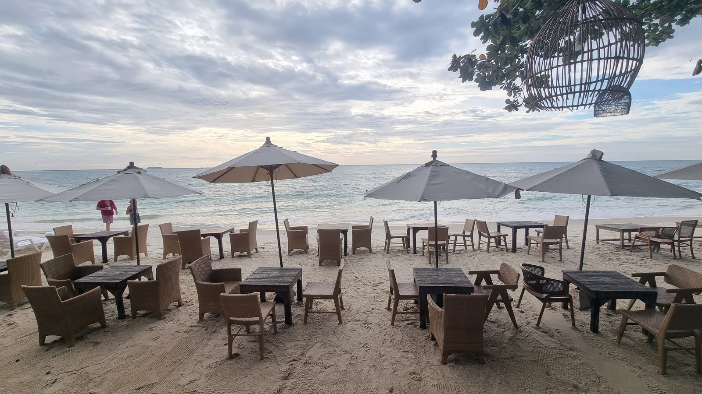

# Silver Sand Resort

Небольшой отель на пляже Ао Пхай, остров Кох Самет, Таиланд.

<h2 id="beach">Пляж Ао Пхай</h2>

Ао Пхай — маленькая бухта рядом с Сай Кэу: с главного пляжа сюда можно дойти пешком, перебравшись через камни. Песок светлый, вода у берега прозрачная и бирюзовая, а в утренние часы прямо напротив отеля плавают мелкие рыбы — с маской их видно без заплыва. Под деревьями выстроились шезлонги и белые зонты, ближе к вечеру у воды ставят деревянные столики, а закат с тёмными валунами на берегу — самое фотогеничное время. В бухте спокойнее, чем на Сай Кэу: здесь хорошо читать, загорать и никуда не спешить.



<h2 id="rooms">Номера и бунгало</h2>

Жильё — белые бунгало с черепичными крышами, одно- и двухэтажные, у каждого своё крыльцо с лежаком. Внутри светло и просто: белое постельное бельё, картины на стенах, кондиционер и большие раздвижные двери, которые открываются на балкон или прямо в сад. На втором этаже — балкон с видом, а садовые бунгало стоят в зелени, в стороне от береговой линии. Отель работает с 1990 года и в 2024-м прошёл обновление: сад за это время разросся, а номера остались просторными и ухоженными. Главная здешняя роскошь — распахнуть дверь и оказаться в саду или на песке.



<h2 id="grounds">Территория</h2>

Территория утопает в зелени: мощёные дорожки вьются между клумбами, а низкие корпуса наполовину прячутся за пальмами. В тени больших деревьев — терраса, где хорошо сидеть с книгой, плетёные кресла под зонтами на лужайке и терраса ресторана с фонариками в металлических клетках. Днём тут тень и прохлада, а вечером включаются гирлянды цветных лампочек и фонари — и весь декор берут на себя они. По дорожкам приятно возвращаться с пляжа: песок остаётся на берегу, а вокруг — кактусы, орхидеи и пальмы.



<h2 id="food">Еда и бар</h2>

Ресторан Silver Sand Restaurant работает с 08:00 до 22:00 и стоит прямо на песке: завтрак подают у моря, с видом на воду, и гости хвалят его чаще всего. В меню — тайская и итальянская кухня, морепродукты, снеки и коктейли; на снимках — салат из зелёной папайи с креветками, жареное и яркие красные коктейли, а кокосы подают с надписью «Silver Sand Resort Koh Samed». Кофейный и коктейльный бар открыт с 8:00 до 21:30, на песке работает пляжный бар, мини-маркет — до 22:00. Вечером на пляже устраивают фаер-шоу, а клуб Silver Sand Club открывается в 20:00 — вечерняя жизнь здесь начинается сама собой.



<h2 id="about">Кому подойдёт</h2>

Больше всего здесь понравится парам и семьям: пляж — сразу за территорией отеля, до песка меньше минуты, а купаться и смотреть рыбок можно прямо напротив отеля. Детям — семейные номера и детские игрушки, взрослым — массаж, снорклинг, дайвинг и прокат байков, чтобы объехать остров. Отель небольшой, на 64 номера, работает с 1990 года и в 2024-м прошёл обновление: всё рядом, всё знакомо, и никуда не нужно спешить. На Google у отеля 4,1 по примерно 800 оценкам, на Trip.com — 8,9 из 10; выше всего гости ставят расположение (9,3) и чистоту (8,8).

<h2 id="visit">Практические детали</h2>

Стойка регистрации работает с 6:30 до 22:00. Всё нужное на каждый день — ресторан, магазин, бар, выход к пляжу — есть на территории, а паром у причала Надан — самый простой способ приехать и уехать. Цены и наличие номеров я не привожу сознательно: они меняются, а пляж, густой сад и вечерние огни на берегу — остаются.

**[Silver Sand Resort · Кох Самет, Таиланд](#)**\
[Пляж](#beach) · [Номера](#rooms) · [Территория](#grounds) · [Еда](#food) · [Для кого](#about)
